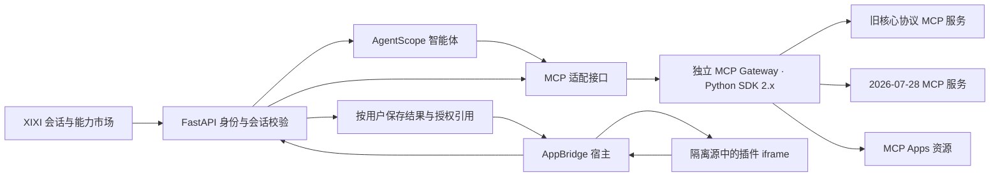

# MCP 插件接入兼容性调研与改造方案

调研日期：2026-10-21

对象：XIXI Agent Studio；仓库基线 `0ef99c5`、本地 Python 环境及官方规范。
状态：需求调研与改造建议，未实施代码迁移。版本结论是本次核查快照，实施时需复核发布与安全公告；本地安装版本不代表线上部署版本。

## 一、结论与范围

当前项目确实落后于最新 **MCP 核心协议**，但对 **MCP Apps** 更准确的描述是“尚未接入”，而不是“已经接入一个旧版 Apps 协议”。

需要分清三件事：

|层次|作用|本次结论|
|-|-|-|
|MCP 核心协议|发现服务、调用工具、读取资源及协商能力|本地 SDK 支持到 `2025-11-25`；官方最新稳定规范为 `2026-07-28`|
|MCP Apps 扩展|在会话中展示并操作第三方 HTML 界面|项目没有 UI 扩展协商、资源加载与 AppBridge 宿主；当前不能完整展示 MCP App|
|SDK 与安装包|实现协议的库、服务启动或分发方式|SDK 版本不是协议日期；支持 MCP Server 不等于支持任意插件安装包|

建议顺序：**新旧 MCP 协议适配与连接认证 → 完整结果链路 → MCP Apps 宿主 → 按目标插件补齐长任务等扩展。** 保留现有 AgentScope 智能体、能力市场和聊天框入口，不因接入插件重做产品导航。

本期优先支持远程 HTTP 连接器及网页会话中的标准 MCP Apps；不承诺任意 `npx`、`uvx`、本地 STDIO 包、MCPB 安装包或厂商私有 UI SDK 一键兼容。实际插件清单、部署地址及授权方式尚未提供，本调研不将任何具体商业插件标记为“已联调通过”。

## 二、版本核查与证据

### 2.1 本地环境与官方发布

|对象|项目现状|本次查到的官方状态|判断|
|-|-|-|-|
|AgentScope|本地 `2.0.4.post1`；`pyproject.toml` 固定该版本；`service/requirements.txt` 使用最低版本约束|最新稳定版 `2.0.10`，2026-10-12 发布|两处依赖约束不一致，需统一；不能只修改其中一处|
|Python MCP SDK|本地 `mcp==1.28.1`，支持 `2024-11-05`、`2025-03-26`、`2025-06-18`、`2025-11-25`|最新稳定版 `2.3.0`，2026-10-02 发布|尚不支持原生 `2026-07-28` 请求路径|
|AgentScope 的 MCP 依赖|安装包元数据要求 `mcp<2.0.0`|最新 AgentScope `2.0.10` 的 PyPI 元数据仍要求 `mcp<2.0.0`|不能在同一环境强装 MCP 2.x，也不能假定升级 AgentScope 就解决新版协议问题|
|MCP Apps SDK|项目未安装 `@modelcontextprotocol/ext-apps`|最新稳定版 `2.0.3`，2026-09-25 发布|需要新增宿主依赖与桥接能力|
|MCP Apps 线协议|项目未实现|本次核查的稳定规范为 `2026-01-26`|与核心 MCP `2026-07-28` 是两个版本维度|

版本依据：[MCP 最新规范](https://modelcontextprotocol.io/specification/latest)、[Python SDK v2.3.0](https://github.com/modelcontextprotocol/python-sdk/releases/tag/v2.3.0)、[AgentScope v2.0.10](https://github.com/agentscope-ai/agentscope/releases/tag/v2.0.10)、[AgentScope PyPI 元数据](https://pypi.org/pypi/agentscope/json)、[MCP Apps v2.0.3](https://github.com/modelcontextprotocol/ext-apps/releases/tag/v2.0.3)。

**MCP Apps SDK 2.x 不等于 Apps 线协议发生不兼容升级。** 官方 2.0 发布说明明确：1.x 与 2.x View/Host 可互通，主要变化是 TypeScript SDK 的分包、依赖与 API。`ext-apps@2.0.3` 需要 MCP TypeScript 2.x 的 `core`、`client` 以及 Zod 4.2+；React 19 在其支持范围内，`server` peer 仅服务端辅助能力需要。[官方 2.0 迁移说明](https://github.com/modelcontextprotocol/ext-apps/releases/tag/v2.0.0)、[npm 包元数据](https://registry.npmjs.org/@modelcontextprotocol/ext-apps/latest)。

### 2.2 当前代码链路

|位置|核查结果|影响|
|-|-|-|
|[连接器保存与调用](../service/capabilities.py)|保存地址后只保留 `url`、固定 `transport`；创建 AgentScope `MCPClient`，未配置认证头或 OAuth|主要覆盖无需认证的远程工具；认证、能力配置无法从产品侧传入|
|[连接器测试](../service/capabilities.py)|只返回工具名称、说明及数量|“发现工具”不能证明工具可执行、资源可读或 App 可展示|
|本地 AgentScope `mcp/_mcp_client.py`|每次临时连接仍执行 `ClientSession.initialize()`；通过 URL 后缀猜测旧 SSE 或 Streamable HTTP|`is_stateful=False` 只是 SDK 连接生命周期选择，不是新版 MCP 的无握手协议；保存的 transport 与实际选择可能不一致|
|本地 AgentScope `tool/_adapters.py`|转换 `result.content`；未完整保留 `structuredContent`、结果 `_meta` 和工具 UI 描述；部分资源内容被跳过|插件数据及 UI 关联信息在进入前端前可能丢失|
|[运行时事件映射](../service/runtime.py)|主要向页面转发文本工具结果并截断长度；未处理完整的二进制工具结果事件链路|图片、资源链接等不能据 SDK 能力推断为前端已支持|
|[会话工具渲染](../app/AssistantConversation.tsx)|以折叠工具卡片展示参数和结果文本/JSON|没有交互 HTML 宿主、双向通信、CSP 或 App 生命周期|
|[连接器管理](../app/StudioConsole.tsx)|当前界面注明支持无需认证的 Streamable HTTP 服务|缺少授权、版本识别、能力与兼容性状态|
|`.codex/config.toml`|MasterGo 是开发工具环境中的 MCP 配置|不等于 XIXI 应用内已经支持 MasterGo 或本地 STDIO 插件|

本地无网络探针已复现：向当前 `MCPTool.call()` 输入同时包含文本、`structuredContent` 和结果 `_meta` 的模拟响应，输出只保留文本块，metadata 为空，未保留另外两类数据。取证见 `outputs/mcp-research/local-adapter-probe.json`。这是适配器验证，不代表真实插件已联调。

现有正向基础应保留：连接器按用户归属管理；智能体与本轮资源范围校验；技能、连接器每轮选择上限；工具权限确认；RunActivity 执行过程展示。新增 UI 操作必须进入同一权限和审计链路。

## 三、与新版的关键差距

### 3.1 MCP 核心协议

下表聚焦影响插件接入的变化，具体消息和回退规则以[官方变更说明](https://modelcontextprotocol.io/specification/2026-07-28/changelog)及[版本兼容规范](https://modelcontextprotocol.io/specification/2026-07-28/basic/versioning)为准。

|维度|当前链路|新版要求及改造影响|
|-|-|-|
|初始化与版本|依赖 `initialize` 握手|`2026-07-28` 改为请求级版本/能力元数据，增加 `server/discover`；旧服务器仍需旧流程，必须支持两代路径|
|HTTP 会话|使用旧 SDK 会话语义|新版取消协议级 Session ID；不能把旧的 `Mcp-Session-Id` 设计直接搬到新模式。应用自己的用户、会话和调用 ID 仍要保留|
|HTTP 请求与缓存|未展示协商结果与缓存策略|需要新版方法、名称等请求头，以及列表/资源返回的缓存声明；缓存不得跨用户和授权边界复用|
|多轮补充输入|只有 AgentScope 工具审批流程|新版 MRTR 可返回 `resultType: input_required`，补充输入后重试原请求；它与“批准一次写操作”不是同一件事|
|返回数据|偏文本转换|新版结果区分 `complete`、`input_required`；`structuredContent` 可为任意 JSON 值，应保留数组、标量和 null，而不只支持对象|
|变更订阅|产品侧未接入|新版使用 `subscriptions/listen`；不能继续假定旧 GET 通知流及资源订阅方法|
|长任务|统一短时工具调用；自动化由项目自身调度|新版 Tasks 是可选扩展，不等同于项目的定时任务。需按插件能力处理远程任务句柄和后续输入|
|连接中断|缺少面向插件的结果未知状态|新版不沿用旧 SSE 消息重放机制；写操作不能因断线而盲目重新执行|
|授权兼容|产品尚无 OAuth 流程|新版已将 OAuth 动态客户端注册列为弃用机制；设计优先支持 Client ID Metadata Documents，旧注册仅作兼容，并校验授权发行方|
|旧能力|底层可能支持旧 SSE 等|旧 HTTP+SSE 应限定为兼容模式；Roots、Sampling、Logging 等已进入弃用策略，不宜作为新接入的默认建设目标|

注意：**旧 HTTP+SSE 传输与 HTTP 响应采用 SSE 格式不是同一概念。** Streamable HTTP 仍可使用流式响应，不应为了“去旧 SSE”关闭所有事件流。

### 3.2 MCP Apps

依据[官方概览](https://modelcontextprotocol.io/extensions/apps/overview)及[稳定扩展规范](https://github.com/modelcontextprotocol/ext-apps/blob/v2.0.3/specification/2026-01-26/apps.mdx)，需补齐以下链路：

1. 协商 `io.modelcontextprotocol/ui` 能力。旧核心协议在初始化阶段协商，新核心协议按请求能力元数据处理，不混用两个时代的消息格式。
2. 识别工具的 `_meta.ui.resourceUri`，通过同一服务器的 `resources/read` 获取 `ui://` 资源，识别 `text/html;profile=mcp-app`。
3. 使用官方 AppBridge 及隔离 iframe 承载 UI；Apps 自己的 `ui/initialize` 握手仍存在，不能因新核心协议移除 `initialize` 而一并删掉。
4. 在 UI 初始化后发送完整工具输入，再发送工具结果；支持取消、加载失败、卸载和重新打开。
5. 区分工具描述元数据、模型可见的结果数据、仅供 UI 使用的结果 `_meta`，不能全部拼进模型上下文。
6. 正确处理 `_meta.ui.visibility`：仅 `app` 可见的工具不得注册给模型；仅 `model` 可见的工具不得由 App 调用。UI 可见不代表用户有调用权限。
7. 可选兼容旧的扁平 `_meta["ui/resourceUri"]`，在单一适配层归一化并给出诊断，不将厂商私有 UI API 当作标准协议。

## 四、插件适配判断

|目标插件形态|当前适配情况|改造后的策略|
|-|-|-|
|无需认证、支持旧核心协议的远程工具|已有基础调用能力，仍需实际联调|保留；迁移后回归工具发现、调用和审批|
|同时支持新旧核心协议的远程工具|可能协商到旧版|展示实际使用版本，不因为连接成功就宣称原生新版支持|
|只支持 `2026-07-28` 的服务|当前初始化链路无法直接兼容|由独立 MCP 2.x 适配服务处理|
|Bearer/API Key 服务|产品没有凭证配置入口|增加服务端加密凭证与请求认证；不在 URL 放密钥|
|需要 OAuth 的服务|未接入完整授权与刷新|增加授权发现、浏览器授权、回调和刷新管理；以实际授权范围验收|
|返回图片、资源链接、结构化数据的工具|结果链路不完整|完整保存并分类渲染；资源读取仍校验权限|
|标准 MCP App|不能展示交互 UI；文本回退也取决于服务返回内容|补齐 Apps 宿主；加载失败时保留可用文本和结果，不伪装交互成功|
|MCP Apps SDK 1.x / 2.x 构建的 View|项目均未实现宿主|按线协议和实际能力验收，不能只按 npm 主版本拒绝旧 View|
|只提供 STDIO、安装命令或插件包|应用不支持安装和启动|首期要求远程部署，或后续使用隔离执行器；不直接在 Web 服务执行任意安装命令|
|依赖厂商私有 JS 接口的 App|不能保证兼容|独立适配、降级或明确不支持；不列入标准 MCP Apps 默认兼容承诺|
|仅有界面、没有文本回退的 App|当前不能正常交付|明确提示缺少所需能力；无浏览器渠道不能只返回空白“成功”|

## 五、产品需求

### 5.1 连接器管理

入口保持「能力市场 → 连接器」，不增加平行的插件管理入口。

- 配置名称、服务地址、显式传输类型、认证方式；高级设置提供可配置超时。旧 URL 配置可迁移为旧协议自动识别模式，不删除既有资源 ID。
- 首期认证覆盖无需认证、API Key/Bearer、OAuth；OAuth 需包含 PKCE、state、发行方校验、授权范围和撤销/刷新处理，不只增加一个“登录”按钮。服务端保存密钥，页面只返回已设置状态。导出备份、错误消息和日志不得带出凭证。
- 测试连接拆分为版本识别、认证、工具发现、资源能力、Apps 能力等结果。连接成功、授权成功和某个业务工具执行成功分开显示。
- 展示服务器名称、实际协议版本、工具数量、是否支持 App、最近检查时间及需要用户处理的问题。App 可用标记必须基于验证结果，不能只检查 `_meta` 是否存在。
- 错误区分服务不可达、需要登录、授权过期、协议不兼容、工具不可用、资源不可读、App 加载失败；保留重试和重新授权入口。
- 连接器停用、删除、凭证失效或配置变更后，使相关调用授权和缓存失效；已有历史会话保留可读结果。

### 5.2 对话体验

- 聊天框继续通过“＋ → 连接器”选择资源；沿用智能体绑定范围及每轮最多 3 个连接器的规则。一个连接器提供多少个工具不改变该上限。
- 工具执行过程继续进入 RunActivity；有 App 的工具，在结果区域展示交互卡片，默认内联，支持展开、收起、重试加载和返回文本结果。
- 最终回复和需要处理的确认不藏进执行过程折叠区。展开执行过程不重复调用远程业务工具。
- 主题、语言、容器宽高通过宿主上下文传递；不要求第三方 View 直接读取 XIXI 的 DOM 或本地存储。
- App 触发工具调用时，后端再次验证用户、会话、连接器、工具及参数；审批通过后才执行受保护操作。不得因点击来自 UI 而跳过权限确认。
- App 更新模型上下文不自动开启新一轮对话；App 请求发送消息时给出可感知的交互，受理后纳入正常会话轮次、用量与取消逻辑。
- 历史记录可恢复已保存的展示结果，但不自动重放写操作；如 UI 资源已变化或授权失效，提示重新加载或授权。

### 5.3 自动化、远程助理与无人值守场景

- 自动化和远程助理继续调用同一连接器适配层，复用授权边界和结果存储。
- 网页之外默认返回文本、结构化摘要或可访问的产物链接；不宣称飞书、钉钉可直接运行浏览器 iframe。
- 必须在 UI 内完成输入的插件，未具备对应通道时进入等待处理或明确不兼容，不伪造完成状态。
- 任务执行完成与“用户打开了插件卡片”分开记录；没有用户打开页面也应保存执行结果。

## 六、技术改造方案

### 6.1 推荐架构

推荐在独立服务/运行环境中使用 MCP Python SDK `2.3.0` 建设 Gateway；现有 AgentScope 环境保持可工作的依赖，先通过受控工具适配接口调用 Gateway。该“Gateway”是拟建设的内部服务，不是项目已有组件。

理由：最新版 AgentScope 仍约束 `mcp<2.0.0`；强行同环境覆盖存在明确依赖冲突。独立服务可以兼容新旧核心协议，也能保留 Apps 原始元数据，避免继续依赖会丢失结果信息的旧转换层。

- 不仅替换“测试连接”接口；模型发起的工具调用也必须经过新适配层，否则会出现“连接测试正常、正式运行仍使用旧协议”的分裂。
- AgentScope 侧注册适配后的工具，保留工具 schema、名称映射及权限控制。工具身份采用连接器 ID 与原始工具名组合，避免不同服务的同名工具相互覆盖。
- FastAPI 向 Gateway 传递经服务端签发的短时调用上下文；不信任浏览器或 iframe 自报的用户 ID、连接器 ID、可用工具列表。
- 网关必须验证内部调用身份和授权上下文；不能成为任何人都可访问的任意 URL 代理。
- 后续 AgentScope 正式兼容 MCP 2.x 后，可替换适配实现，保留前端和业务 API，不再新增第三套调用路径。

备选是独立 Node/TypeScript 2.x 网关，适合团队已有该部署基础时选用。本方案优先复用现有 Python 服务栈，PoC 后确定一种实现，不同时维护两套新网关。

### 6.2 协议与能力适配

- 使用官方 SDK 的两代兼容机制，记录选定的核心协议、认证与扩展能力；不通过改协议日期字符串模拟升级。
- 按规范处理新版错误与旧协议回退。认证失败应进入授权流程，不通过降级绕开认证；真正没有共同版本时给出支持版本列表。
- 遵守 `ttlMs`、`cacheScope` 及配置版本；私有授权下的列表、资源和 App 数据不得跨用户共享。新版“无连接会话”不意味着无用户隔离。
- App 能力只有在宿主和安全容器真实可用后才声明；纯文本运行通道按实际能力声明，不能为了拿到 App 工具而虚报能力。
- 首期未实现的 MRTR 输入、Tasks、特殊订阅等应明确拒绝或禁用，不在能力报告中标记支持。

### 6.3 结果与持久化

新增版本化的内部结果封装，至少保存：

|类别|建议字段/内容|
|-|-|
|关联标识|用户、会话、消息、toolCallId、连接器 ID、连接器配置版本、原始工具名|
|协商信息|核心协议版本、Apps 协议/能力、所用适配路径|
|工具描述|inputSchema、outputSchema、annotations、工具 `_meta.ui` 与 visibility|
|结果内容|完整内容块类型、`structuredContent`、`isError`、`resultType`；原始与归一化结果的对应关系|
|UI 专用内容|工具结果 `_meta`、UI 资源 URI、资源内容 hash、CSP 和权限策略引用|
|执行状态|开始/结束、取消、审批、补充输入、结果未知、错误类别及审计标识|

- 当前 `parts_json` 中的旧文本工具消息继续可读；新增字段带 schema 版本，支持混合历史。
- 将模型可见结果与 UI 专用数据分开存储和传输，不把全部 `_meta` 注入提示词。可读取 App 的用户也必须拥有对应会话和连接器权限。
- 大型图片、音频或文档存储为受控产物/资源引用；不要通过 24000 字符文本截断处理整个插件结果，也不要将二进制直接塞入每帧 SSE。
- 文件链接通过项目现有权限和存储层发放；从 MCP URI 到可下载文件的转换需显式实现，不能把任意 `ui://` 当作 HTTP 地址访问。
- UI 资源缓存按服务器身份、配置版本、授权范围和内容版本隔离，更新后允许受控刷新，不用旧快照冒充最新资源。

### 6.4 前端宿主

- 采用 `@modelcontextprotocol/ext-apps@2.0.3` 的官方 `AppBridge`，按 peer 要求引入 MCP TypeScript 2.x 的 `core`、`client` 和 Zod；只为宿主使用时不额外引入不需要的服务器运行依赖。
- 参考官方宿主与 sandbox proxy 架构，使用独立、无业务登录态的资源域名。不能直接在主页面 `dangerouslySetInnerHTML` 渲染第三方 HTML，也不能只放一个无约束的同源 `srcdoc` iframe。
- 由宿主执行 CSP，未声明的网络和资源域名不得放行；默认拒绝摄像头、麦克风、地理位置等额外权限。
- 校验 postMessage 来源窗口、预期 origin 与桥接实例；按官方 sandbox 协议处理需要的中继消息，不接受任意页面发来的工具请求。
- 使用工具可见性与服务端 ACL 双重校验；首期仅允许 App 访问自己的连接器及被授权的工具/资源，不提供跨连接器隐式调用。
- UI 只能请求外链、下载、发送消息等能力，最终由宿主判定是否受理；不得把平台 token、模型密钥或 MCP 凭证交给 iframe。

参考：[官方 AppBridge](https://apps.extensions.modelcontextprotocol.io/api/modules/app-bridge.html)、[MCP Apps 宿主示例](https://github.com/modelcontextprotocol/ext-apps/tree/main/examples/basic-host)。

### 6.5 代码与接口落点

以下均为拟新增或拟修改项，不代表已存在接口。

|位置|改造内容|
|-|-|
|`mcp-gateway/` 或独立部署仓库|独立锁定 MCP 2.x 依赖；实现版本兼容、工具与资源调用、授权会话及扩展能力|
|`service/mcp/`|Gateway 业务适配、AgentScope 工具包装、权限复核、统一错误与审计|
|`service/capabilities.py`|扩展连接器配置与测试；逐步替换现有调用构建，保留资源归属和智能体绑定约束|
|`service/main.py`|连接测试报告、授权与回调、App 实例与工具/资源代理接口|
|`service/runtime.py`|转发完整工具结果封装及 App 关联事件；保持取消、审批、用量统计和历史消息兼容|
|`app/StudioConsole.tsx`|连接器认证、兼容性结果、App 支持状态及故障恢复入口|
|`app/AssistantConversation.tsx`、`app/McpAppHost.tsx`|工具结果分型渲染、AppBridge 卡片和加载/降级交互|
|数据层与迁移|凭证引用、能力快照、结果数据与 UI 资源记录，兼容 SQLite 和 PostgreSQL 部署|
|依赖与部署配置|统一 AgentScope 约束，分别锁定 Gateway、前端依赖，增加 sandbox 资源源与 CSP 配置|

接口职责应覆盖：兼容性探测、授权建立与刷新、App 实例创建、工具调用、资源读取、实例关闭/撤销。调用接口使用服务端校验的实例标识，不接收客户端随意指定的目标 URL 或原始请求头。

## 七、安全、运行与降级要求

|问题|需求|
|-|-|
|不可信工具声明|不能单凭远程 `readOnlyHint` 就放开新插件全部调用。当前旧适配器会据此允许只读工具；新链路需叠加来源信任和平台授权策略|
|SSRF|当前仅校验 URL 基本格式；生产环境需校验 DNS、目标 IP、跳转后的目标和出站范围。云服务不得把用户的 localhost 当作其电脑。内网服务采用明确部署与准入方案|
|凭证泄露|私有凭证服务端加密，按用户和连接器管理；OAuth 凭证同时绑定发行方、客户端和资源，备份、日志、UI 结果中均脱敏|
|跨用户访问|会话、App 实例、资源和工具调用逐次校验；停用连接器或撤销授权后，旧页面不得继续操作|
|长时调用|区分连接、发现、业务执行、UI 加载和用户授权等待的超时；不沿用统一 30 秒处理所有插件|
|断线与重试|只读调用可在策略内重试；写调用优先使用插件提供的业务幂等机制。没有幂等支持时，断线标记结果未知，先核查再由用户发起操作，不盲目重复写入|
|UI 故障|保留已收到的文本和结构化结果，提供重新加载 UI；重新加载界面不等于再次执行业务工具|
|服务重启|历史结果保留；交互连接可重建，但写操作、审批、远程任务句柄不能依赖进程内内存作为唯一状态|
|Serverless|当前项目已有 Serverless 演示模式。不能在每次函数请求中创建常驻子进程；新 Gateway 独立部署。首期不声明演示部署支持无人值守长任务和持久订阅|

## 八、分期与上线顺序

|阶段|交付物|进入下一阶段的条件|
|-|-|-|
|A：依赖与兼容性 PoC|锁定版本；独立 SDK 2.x Gateway；新旧协议测试服务；复现现有结果信息丢失|确认与现有 AgentScope 无依赖冲突，原有工具回归正常|
|B：远程插件基础接入|无认证/API Key/OAuth；协议识别；完整结果链路；真实执行走新适配层|连接测试与正式执行一致；权限、密钥、资源读取和旧消息兼容通过|
|C：MCP Apps 首期|AppBridge、独立隔离源、UI 资源代理、工具调用与文本降级|只读图表和受控写入表单两类 App 通过验收；历史可恢复展示|
|D：按插件需要扩展|MRTR 补充输入、Tasks、订阅；受控 STDIO/安装包方案|提供具体目标插件和运行环境后单独排期，不把全部扩展塞入首期|

对于只需后台查询、商品分析、读取文件的插件，可以先交付阶段 B；只有需要表格、图表、表单等交互时再开放阶段 C。无需为了接入普通工具强制要求其提供 App。

上线采用按连接器/用户开关灰度：先只读示例，再认证插件，再需确认的写工具。保留旧链路回退开关，但已迁移的调用不得在同一操作中同时执行新旧两条路径。新协议专属插件回退时应明确不可用，不能降级后假装执行成功。

## 九、验收与联调清单

### 9.1 协议和插件能力

1. 旧 `2025-11-25` 服务：发现、调用、审批、错误和取消正常。
2. 仅 `2026-07-28` 服务：使用新版路径；不发送旧初始化握手或旧 Session ID。
3. 两代服务：显示实际使用版本；不支持的版本有可理解的诊断。
4. 新版请求的能力、请求头、缓存声明按 SDK 与规范处理；不自行拼接缺失协议行为。
5. 认证失败进入授权/重新授权；不能把权限问题误报为“旧版兼容成功”。
6. 返回对象、数组、标量、null、图片、资源链接以及业务错误时，数据均不因文本转换而丢失。
7. 不同连接器工具同名、能力变化及权限变化时，调用身份和缓存仍正确。

### 9.2 MCP Apps

8. `_meta.ui.resourceUri` 对应 HTML 可读取，UI 初始化、完整输入、结果推送顺序正确。
9. 使用官方示例验证 SDK 1.x 与 2.x View，不仅按包版本判定不兼容；记录实际协议和能力。
10. 仅 App 可见的工具不进入模型工具列表；仅模型可见的工具不能从 App 调用。
11. 图表支持刷新；写入表单必须确认，拒绝后无写入副作用；操作均有调用记录。
12. 点击 UI 重载不重复执行工具；历史会话打开不自动重放修改数据的操作。
13. UI 更新上下文不自动开启推理循环；发送消息、并发点击、取消均受会话状态约束。
14. 资源不存在、MIME 不支持、初始化超时、CSP 拒绝时有明确降级与可读结果。

### 9.3 权限和部署

15. A 用户不能读取、加载或操作 B 用户的 App 实例、资源和授权。
16. 未声明域名、伪造 postMessage、跨连接器调用、停用后的旧实例均被拒绝。
17. 模型输入、页面网络数据、导出备份与普通日志不含私有密钥或 UI 专用敏感数据。
18. 网关不可达或重启后，对未知写入结果不自动重放；已保存结果仍可读取。
19. 自动化和远程助理得到可读回退或等待处理状态，不因没有网页容器而默默丢失结果。
20. 持久服务和 Serverless 演示部署分别声明已支持能力，不以开发环境成功代替线上验收。

测试先使用可控制的本地示例服务复现协议与错误，再按真实目标插件逐一联调。首批真实联调建议覆盖：一个无需认证只读工具、一个需授权连接器、一个只读 App、一个需审批写入 App；可由同一插件覆盖多项。未提供具体插件前，不给出其已适配结论。

## 十、待确认与本次产出边界

- 需要实际接入的插件清单：服务地址、传输方式、认证方式、是否提供标准 App、是否有旧协议回退。
- 目标是本机持久部署、云端持久部署还是 Serverless 演示版；是否具备独立 sandbox 域名。
- 首批是否包含店铺写入、长任务、企业授权或本地安装包；据此确定阶段 B/C/D 的范围。

本次已完成代码与依赖审查、本地适配器结果探针、官方规范及公开发布元数据核对、差距分析和改造规划；未升级生产依赖、未连接真实商业插件、未实施网关或 iframe 宿主。源码与官方资料取证保存在本地 `outputs/mcp-research/`，该目录不是项目依赖，也不参与运行。
