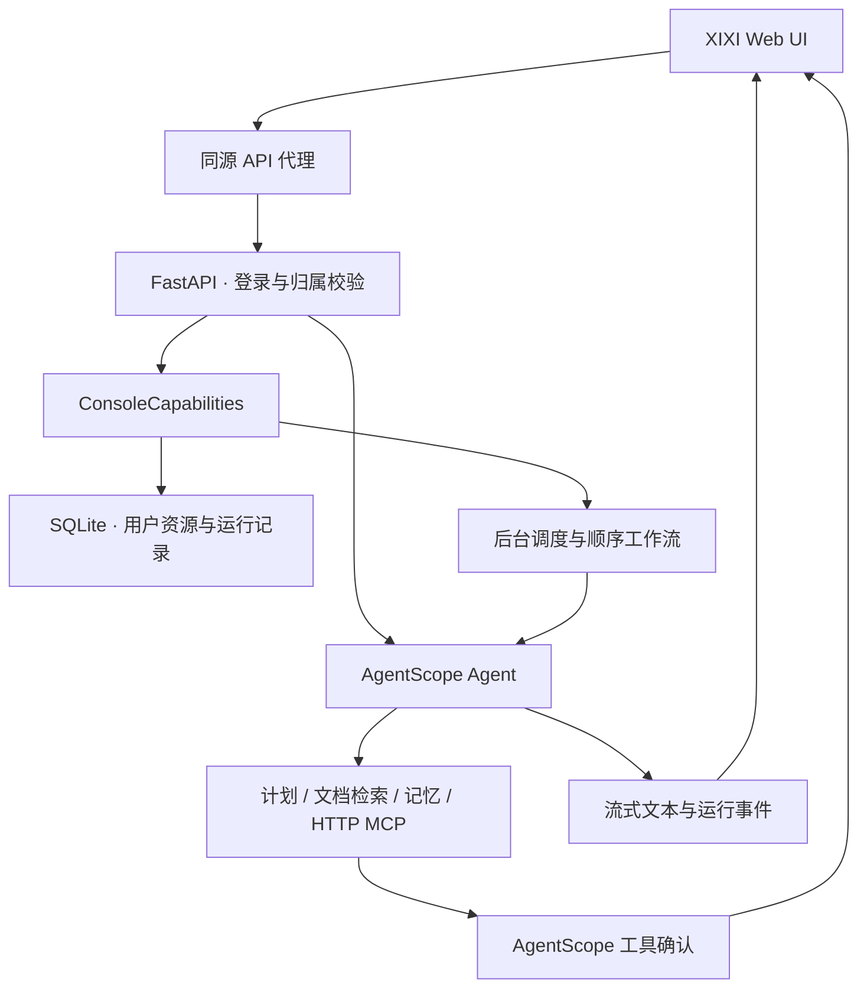

# AgentScope Studio Architecture

当前项目是 QwenPaw 风格的 XIXI 控制台，使用 React / vinext 前端与 FastAPI / AgentScope 后端。

## 执行路径

## 主要模块

- `app/AgentWorkbench.tsx`：导航、对话、会话管理、账号与模型设置。
- `app/StudioConsole.tsx`：Skills、MCP、知识、记忆、工作流、定时任务、概览与资源备份。
- `app/MarkdownMessage.tsx`：Markdown / GFM 渲染，不启用原始 HTML。
- `app/api/console/[...path]/route.ts`：透传同源控制台 API 的状态码与登录凭据。
- `service/runtime.py`：真实 AgentScope 工具、MCP、上下文、SSE、单会话并发保护与确认恢复。
- `service/store.py`：SQLite 用户、模型、会话、消息、事件、计划与共享项目文档索引。
- `service/capabilities.py`：用户资源校验、持久化、上下文检索、HTTP MCP、执行快照、后台运行与调度。
- `service/main.py`：授权与用户归属校验、资源和会话 API、后台任务生命周期。

## 数据与隔离

控制台资源以 `user_id` 为边界。用户只能读取或修改自己的模型、会话、记忆和扩展。项目 README / docs 是共同可读的项目资料。浏览器会话缓存也按账号分开。

知识与记忆来自真实保存的文本。工作流使用同一个 Agent 的有序提示词步骤，确认后按执行快照继续后续步骤。定时器在服务在线时检查到期任务；重启后原运行标记为中断，避免把已执行的写入自动重复执行。

## 后续扩展

多 Agent Team、向量检索、文档解析、MCP 认证、IM 渠道、语音、沙箱、分布式队列与生产密钥管理尚未接入。

详细能力与限制见 [QWENPAW_ADAPTATION.md](QWENPAW_ADAPTATION.md)。
