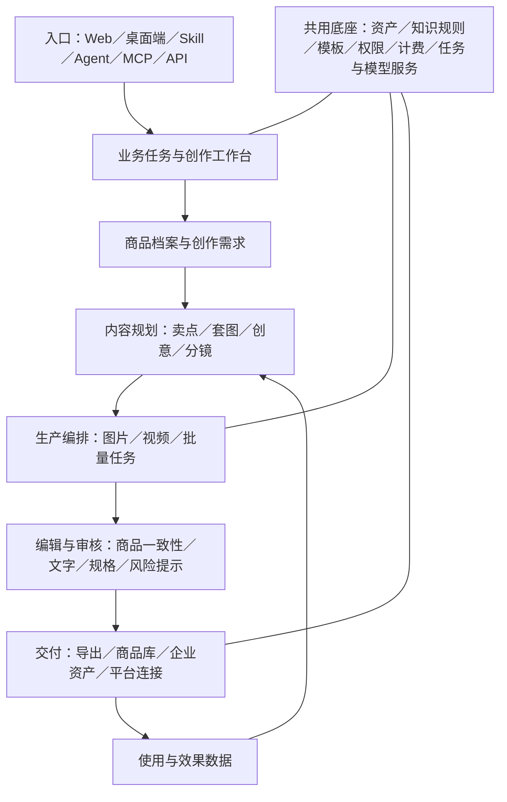

# AI 电商内容生产平台：产品架构与分期规划

- 版本：v1.0
- 日期：2026-10-30
- 状态：立项讨论稿，待商家访谈、业务数据及技术验证后定版
- 适用范围：商品图片、营销图片、商品视频、内容资产与效果闭环
- 文档定位：目标产品架构；不代表下列功能已实现或已接通平台

## 1. 产品定位与立项目标

面向有持续上新、多 SKU、多市场经营需求的电商商家和服务团队，提供以真实商品资料为基础的内容生产、修改、审核、交付与复用能力。

核心交付单位是“某商品在某渠道、某市场的一组可使用内容”。产品应支持用户完成业务任务，并能追溯时间、费用、质量和实际使用情况。

### 1.1 优先用户

| 用户 | 主要任务 | 价值假设 |
| --- | --- | --- |
| 电商运营、跨境卖家 | 上新刊登、旧图优化、多平台与多语言适配 | 缩短上新周期，减少反复修改 |
| 品牌内容与广告团队 | 持续生产素材、批量创意测试、更新活动内容 | 降低有效素材成本，提高迭代效率 |
| 服务商、企业设计团队 | 批量生产、多品牌协作、审核交付 | 提高交付产能与资产复用率 |
| POD、商品开发团队 | 图案设计、效果预览、包装方案、打样交付 | 减少方案探索与改稿时间；作为后续扩展用户 |

上述优先级是产品假设。平台官方资料能够验证内容要求和平台约束，不能直接证明目标客户的需求频次或付费意愿。

### 1.2 立项目标

1. 跑通商品资料到合格内容交付的完整流程。
2. 提高商品外观、SKU 和品牌信息的一致性。
3. 支持套图、批量任务和多渠道版本生产。
4. 保留人工可编辑、可审核、可追溯的控制能力。
5. 衡量实际采用及业务使用，建立持续优化依据。

## 2. 需求重构原则

### 2.1 按业务任务组织产品

将商品刊登、存量优化、营销创作、视频生产、本地化作为主要场景；抠图、扩图、分层、翻译等作为流程内工具，也允许独立使用。

### 2.2 区分三类内容标准

- 刊登内容：强调商品真实、规格适配、完整性和平台要求。
- 营销内容：强调人群、卖点、创意差异和测试迭代。
- 设计交付：强调可编辑性、尺寸与生产文件要求。

Amazon 对主图和其他商品图片分别提出要求；Google Merchant Center 也区分商品图片与促销叠加内容，并要求保留相应 AI 来源元数据。产品应维护不同用途的输出规范。[Amazon 商品图片指南](https://sellercentral.amazon.com/help/hub/reference/external/G1881?locale=en_us)、[Google 商品图片要求](https://support.google.com/merchants/answer/6324350?hl=en)。

### 2.3 平台、市场、品类作为适配维度

统一配置结构：`业务任务 × 内容用途 × 平台/站点 × 目标市场 × 语言 × 品类 × 商品/SKU`。

原有“16 平台、12 国家、6 品类”保留为候选覆盖池。先选实际经营组合验证，再扩展；不以组合数量作为交付完成度。国家、站点、语言和币种分别配置，避免直接互相推导。

### 2.4 商品事实与创意表达分开管理

商品结构、颜色、数量、规格、包装文字和功能描述来自用户确认的资料。模型可建议场景、构图、文案和分镜；对商品事实的修改需要用户确认。

### 2.5 规划范围与能力承诺分开

“可生成”不等于“可交付”。每个场景分别标记生成支持、编辑支持、规则检查、业务交付、数据回传的状态。

## 3. 核心业务场景

| 场景 | 典型输入 | 主要输出 | 完成标准 | 建议顺序 |
| --- | --- | --- | --- | --- |
| 商品上新与刊登套图 | 商品档案、真实参考图、目标站点 | 主图、卖点图、细节图、尺寸图、场景图、组合清单图 | 用户审核通过，满足所选渠道规格，可导出或提交 | P0 |
| 存量商品图优化 | 已有商品图、问题说明 | 清理、修复、放大、背景优化后的图片 | 商品事实未被错误修改，问题得到解决 | P0 |
| 多渠道与本地化 | 已确认的套图或视频、目标语言与渠道 | 多尺寸、多语言、不同站点版本 | 文字可读、术语正确、版式和规格可用 | P0 基础，P1 批量 |
| 营销与广告创作 | 商品、人群、卖点、活动信息 | 促销图、上新图、社媒图、多创意变体 | 信息经确认，版本可区分，可进入投放或发布流程 | P1 |
| 商品短视频 | 参考图、实拍素材、商品资料 | 展示、演示、卖点讲解、教程及带货视频 | 商品清楚、信息一致、视听完整、渠道规格可用 | P1 |
| 创意测试与再生产 | 已交付素材、效果数据、测试目标 | 新开头、新文案、新镜头组合或新图片版本 | 版本与数据关联，支持受控比较和复用 | P1 记录，P2 自动建议 |
| POD 图案与商品设计 | 原创或已授权图案、载体模板、印刷要求 | 图案变体、商品效果图、生产文件 | 预览与生产文件分别检查，供应商确认可用 | P2 |
| 新品与包装方案 | 产品需求、尺寸、品牌规范、供应商模板 | 概念方案、包装效果图、标签与展开稿 | 明确设计假设和真实参数，完成设计与生产评审 | P2 |

场景说明：TikTok Shop 视频应突出商品与实际用途，广告创作还涉及开头、节奏、字幕与声音。商品详情视频和广告视频需要分别配置目标与模板。[TikTok Shop 内容相关性指引](https://seller-us.tiktok.com/university/essay?knowledge_id=3547281111025450)、[TikTok 视频广告指南](https://ads.tiktok.com/business/en/guides/video-advertising-guide?redirected=1)。

## 4. 产品总体架构

架构分为业务场景层、生产能力层、资产与知识层、交付运营层及平台基础层。不同入口调用同一任务与权限体系。

## 5. 功能架构

### 5.1 商品与创作需求中心

- 商品档案：商品名称、品类、品牌、规格、尺寸、材质、卖点、使用方式。
- SKU 与组合：款式、颜色、数量、配件及组合清单；参考图与对应 SKU 绑定。
- 商品事实：多角度实拍、细节图、包装图、已确认文案；标记资料缺失与可信来源。
- 品牌规范：LOGO、字体、配色、语气、允许使用的模特及素材。
- 创作需求：用途、平台、站点、市场、语言、受众、数量、交付规格与截止时间。
- 资料确认：生成前展示输入快照；资料不足时提示补充或限定输出范围。

### 5.2 图片生产工作台

#### 场景化生产

- 刊登套图：按商品和渠道选择图片角色、顺序、数量及模板。
- 存量图片优化：诊断问题，支持单图处理及批量应用。
- 营销图片：上新、促销、节日、社媒、广告创意及多尺寸变体。
- 本地化：OCR、术语替换、翻译、文字重排与逐项确认。
- 品类适配：服装穿着展示、家具空间展示、宠物用品使用场景、个护包装与细节等；逐场景验收。

#### 通用编辑工具

- 基础处理：抠图、背景替换、消除、裁切、加框、扩图、高清放大。
- 内容修复：局部重绘、商品细节修复、光影融合、文字与版式修正。
- 服装展示：人台转模特、模特与背景调整；检查服装图案、结构、材质与穿着表达。
- 版本比较：原图对照、局部修改记录、撤销和单张重跑。

#### 套图与批量能力

- 锁定商品参考与品牌规范，保持跨图一致性。
- 按 SKU、语言、尺寸组织批量任务，避免错误替换商品变体。
- 单张审核、整套审核、缺图补齐、失败项重跑。
- 刊登图与营销图分别生成、检查、导出。

### 5.3 视频生产工作台

- 内容规划：商品卖点、目标人群、创意方向、脚本、分镜及素材需求。
- 商品视频：外观展示、细节特写、使用演示、安装或操作教程。
- 营销视频：开头创意、卖点讲解、场景故事、活动与行动引导。
- 参考创作：从用户有权使用的参考素材中提取节奏和结构，进行商品替换、镜头重构及重新创作。
- 素材生产：实拍复用、图片动效、生成镜头、配音、字幕、音乐及封面。
- 视频编辑：镜头排序、裁切、拼接、单镜头重做、局部调整及素材替换。
- 本地化：翻译、配音、字幕重排；口型适配按场景独立验证。
- 结果检查：商品一致性、字幕可读性、音画同步、画幅、安全区与缺失素材。
- 版本生产：同一商品生成不同开头、文案、语言和镜头组合，保留版本关联。

### 5.4 设计交付与专业扩展

- 轻量画布：图片、文字、商品层、品牌组件、版式及尺寸编辑。
- 分层交付：明确可编辑对象、蒙版及文字范围，支持 PSD 等格式的兼容性验证。
- 矢量交付：路径转换、编辑与质量检查；区分原生矢量对象和嵌入位图。
- POD：图案生成、载体预览、印花位置适配、供应商模板与生产文件导出。
- 包装：上传刀模或展开模板，配置真实尺寸、标签文字、条码区域和生产要求。
- 印刷检查：按供应商与工艺要求检查文件、尺寸、分辨率和其他交付参数。
- 真实 3D 建模、服装仿真和工程结构设计作为专项能力评估，不并入普通效果图生成承诺。

POD 效果图与生产文件分别验收。Printful 的资料要求依产品和印刷方式检查格式、分辨率、透明背景等参数，适合采用供应商模板驱动的交付方式。[Printful 文件准备指南](https://help.printful.com/hc/en-us/articles/50264019148177-How-should-I-prepare-my-print-file-for-the-best-results)。

### 5.5 资产、知识与模板中心

| 模块 | 主要内容 | 关键管理要求 |
| --- | --- | --- |
| 商品库 | 商品档案、SKU、参考图、已确认商品内容 | 商品事实、输入快照和内容关联 |
| 素材库 | 图片、视频、模特、语音、音乐、字体 | 来源、使用权限、适用范围、有效期 |
| 企业资产 | 品牌素材、审核通过的作品、可复用组件 | 工作空间归属、访问权限、版本与审批 |
| 知识规则 | 平台要求、品类术语、语言规则、风险检查项 | 来源、适用范围、版本、生效时间、维护人 |
| 创作模板 | 套图结构、版式、脚本、分镜、提示词、风格 | 参数、商品依赖、适用场景、版本和效果 |

模板配置同时包括输入要求、生成步骤、检查规则和交付格式。Skill 负责组织业务流程，模板负责具体结构与参数，二者分别管理。

### 5.6 质量与合规辅助

- 通用质量：清晰度、文字可读性、缺图、重复图、边缘缺陷和视频技术质量。
- 商品准确性：商品形态、颜色、数量、配件、尺寸文字及 SKU 对应关系。
- 渠道适配：主图与附图要求、画幅、尺寸、安全区及适用的 AI 来源标识。
- 内容风险：品牌素材授权、模特和声音授权、表述风险、目标市场敏感内容。
- 包装专项：按品类与市场选择规则包，OCR 提取、字段核对、位置提示、人工复核。
- 问题处理：定位问题区域，提出修改建议，确认后编辑，修改后重新检查。
- 检测结果：区分通过、不通过、待人工确认和无法检测，并保存依据及规则版本。

“FDA 六面图合规检测”重构为“指定品类与市场的包装标签辅助检查”。六面图是资料输入形式；营养标签等应建立专门规则和经确认的数据输入，不由模型自行推算或编造。检查结果不能替代专业审核或认证。相关规则包需另立专项需求与验收方案。[FDA 膳食补充剂营养标签指南](https://www.fda.gov/food/dietary-supplements-guidance-documents-regulatory-information/dietary-supplement-labeling-guide-chapter-iv-nutrition-labeling)。

### 5.7 交付、协作与运营

- 审核交付：按图片、套图或视频提交审核，支持评论、驳回、修改和版本确认。
- 内容导出：平台规格包、命名规则、文件清单及生成来源元数据。
- 业务入库：移入商品库或企业资产，保留目标记录 ID 和操作回执。
- 平台连接：逐个平台评估授权、媒体上传、刊登和发布能力；记录提交、成功、失败与未知状态。
- 社媒管理：先支持内容与账号关联、交付记录；多账号发布、排期及运营能力按实际需求扩展。
- 效果观测：关联内容版本、商品、刊登或广告记录，分析表现并支持再次创作。

区分“已导出”“已提交”“平台接收”“实际展示或发布”。Amazon 明确说明上传图片不保证被展示，因此各状态需要独立记录。[Amazon 商品图片指南](https://sellercentral.amazon.com/help/hub/reference/external/G1881?locale=en_us)。

### 5.8 平台基础与商业化

- 身份与权限：新 UMC、企业工作空间、角色、数据隔离与操作审计。
- 任务中心：队列、进度、取消、超时、失败恢复、部分成功、批量重跑和状态查询。
- 模型服务：供应商适配、路由策略、版本管理、质量评测与故障处理。
- 使用计量：预算预估、额度、实际消耗、失败与退款策略、账单和费用追踪。
- 商业化：按用户与业务验证套餐，逐步接入移动支付、国际支付和企业结算。
- 国际化：界面语言、内容语言、站点、币种、时间及计量单位分别管理。
- 外部接入：Web、桌面端、Skill、Agent、MCP、API 共用任务、权限和计费服务。

## 6. 核心业务流程

### 6.1 刊登套图流程

选择商品/SKU → 检查与补齐资料 → 选择用途和站点 → 确认套图方案 → 预估费用 → 生成 → 一致性与规格检查 → 局部修改 → 人工确认 → 导出/入库/提交刊登 → 接收回执。

### 6.2 视频流程

选择商品与受众 → 导入实拍或参考素材 → 确认脚本分镜 → 生产和组装镜头 → 配音字幕 → 检查与修改 → 输出多个版本 → 审核交付 → 关联发布/广告记录 → 根据数据再创作。

### 6.3 异常处理

- 资料不足：补资料或说明限制，不默认生成不可验证的商品细节。
- 部分失败：保留成功结果，仅重跑失败项。
- 商品失真：定位问题并重做受影响区域或镜头。
- 检查未通过：展示原因、规则来源及可执行的修改建议。
- 外部提交中断：标记结果未知，先查询状态，再决定是否重试。
- 发布或效果数据不可获取：显示不可观测，不记为失败或零转化。

## 7. 数据架构与指标

### 7.1 关键对象与关联

| 对象 | 标识 | 作用 |
| --- | --- | --- |
| 工作空间与用户 | workspace_id、user_id | 身份、归属、权限与统计范围 |
| 商品与 SKU | product_id、sku_id | 关联真实商品及其变体 |
| 业务需求 | request_id | 关联一次上新、营销或设计需求 |
| 生成任务与尝试 | job_id、attempt_id | 记录批量任务、模型调用、失败与重试 |
| 内容及版本 | asset_id、version_id | 标识图片、视频、设计文件和派生关系 |
| 审核与交付 | review_id、delivery_id | 区分确认、导出、入库和外部提交 |
| 发布与实验 | publication_id、experiment_id | 关联实际业务使用及受控效果比较 |

来源字段独立保存：入口、业务场景、调用方、技能 ID、智能体 ID、MCP 客户端标识、内部 Key ID。用户 token 与原始 API Key 不进入埋点；UMC 身份由服务端解析为稳定用户标识。

### 7.2 事件追踪

需求创建 → 资料确认 → 任务提交 → 调用开始 → 生成成功/失败 → 结果交付与展示 → 编辑 → 审核通过/驳回 → 复制/下载 → 入库成功/刊登提交/发布成功 → 反馈与效果回传。

- 服务端记录生成、费用和业务成功回执；前端记录展示与交互。
- 图片与视频逐项关联，套图保留任务级汇总。
- 用事件 ID 去重，记录事件时间、入库时间、业务对象和来源。
- 异步回传补齐原事件关联；记录数据覆盖率和观测缺口。
- 点踩支持商品失真、文字问题、画质、场景不符等原因，允许修正反馈。

### 7.3 指标体系

建议主指标：**周期内完成并被业务采用的合格内容任务数**。配套展示合格交付率、采用率、成本、时长及活跃企业，图片与视频分别统计。

| 维度 | 指标 | 口径与注意事项 |
| --- | --- | --- |
| 交付 | 合格交付率 | 审核通过且完成约定内容交付的任务数 ÷ 有效提交任务数；按成熟队列统计，处理中与取消状态另列 |
| 质量 | 首次验收通过率 | 首次交付即通过审核的任务数 ÷ 已完成首次审核任务数 |
| 使用 | 行为使用率 | 观察期内复制或下载的去重资产数 ÷ 成功交付资产数；不等同于业务采用 |
| 采用 | 业务采用率 | 在约定观察期内成功入库或实际刊登/发布的去重资产数 ÷ 同期成熟队列的成功交付资产数；各动作分开展示 |
| 效率 | 端到端交付时长 | 从有效提交到约定结果就绪；另列模型耗时、排队耗时、人工改稿时长；看 P50、P95 和达标率 |
| 成本 | 有效交付成本 | 含失败与重试的实际费用 ÷ 合格交付量；按图片、视频时长及规格拆分 |
| 反馈 | 点踩率与反馈参与率 | 分别统计负面反馈与反馈覆盖，避免把缺失反馈解释为满意 |
| 覆盖 | 需求覆盖率 | AI 完成的适用需求数 ÷ 全部适用需求数；分母来自业务系统或标注来源的人工统计 |
| 留存 | 企业复用与持续使用 | 企业重复创作、资产复用、周期留存；固定用户队列和统计窗口 |
| 效果 | 点击、观看、转化等 | 仅在获得有效业务数据时展示；保留平台归因窗口，不能把变化直接归因于生成内容 |

原有成本、耗时、采纳率目标作为候选目标，先校准模型、规格、批量、场景和统计窗口，再确定验收阈值。TikTok 提供创意分组测试机制，效果优化应尽可能通过受控测试验证。[TikTok 分组测试说明](https://ads.tiktok.com/resources/help/article/split-testing?lang=en)。

## 8. 分期路线与退出条件

| 阶段 | 重点范围 | 退出条件 |
| --- | --- | --- |
| P0：商品图交付闭环 | 商品与 SKU 基础档案、刊登套图、存量优化、轻量编辑、人工审核、导出入库、任务与成本计量、来源与采纳追踪 | 至少一个真实“品类 × 渠道 × 市场”组合持续完成交付；有可复核的质量、耗时、成本和使用数据 |
| P1：规模化内容生产 | 批量 SKU、多语言与多尺寸、营销图、商品短视频、分镜与镜头编辑、模板配置、团队审核、一个目标平台连接 | 批量生产稳定，商品一致性可评估；业务回执可追踪；代表商家持续使用并验证付费意愿 |
| P2：运营优化与专业设计 | 创意实验、多版本效果回流、社媒排期、POD、分层矢量交付、包装设计与专项规则包 | 每项扩展独立验证需求频次、交付质量、集成可行性和商业价值 |

身份、企业隔离、资产归属、任务持久化和计量作为 P0 基础。复杂支付渠道、完整多账号运营、通用专业画布和真实 3D 仿真可独立分期。

### 8.1 一期建议边界

- 从目标客户已有业务中选定一个主要刊登渠道和少量代表商品，包含 SKU、套装或复杂细节等测试样本。
- 新增渠道按真实需求和集成条件排序，不同时承诺 16 平台完整适配。
- 视频先选一种明确商品任务验证；长视频、复杂人物表演、口型适配另行评估。
- 包装专项先支持导入已确认资料和模板，专业生产及法规审核单独验收。
- 通用工具按核心流程所需接入，避免将工具数量作为一期交付目标。

## 9. 立项前验证与待决策项

| 决策项 | 建议验证方式 | 应形成的结论 |
| --- | --- | --- |
| 谁最需要 | 访谈运营、内容团队及服务商，回看近期真实任务 | 首要客户、任务频次、现有成本与付费主体 |
| 先做什么场景 | 对比上新套图、旧图优化、营销图、短视频的任务样本 | 一期场景、输入输出和成功标准 |
| 商品是否能保真 | 用真实商品建立评测集，覆盖文字包装、反光、透明、细结构等难点 | 可承诺范围、失败类型、人工参与节点 |
| 是否能规模化 | 验证批量 SKU、一致性、排队、重试和规格输出 | 产能、稳定性及有效交付成本 |
| 平台能否接通 | 核实账号授权、接口权限、发布回执和效果数据权限 | 可支持的连接能力及不可观测范围 |
| 专业能力是否成立 | 验证 PSD、矢量、印刷、包装和口型适配样本 | 独立专项范围与验收方案 |
| 如何收费 | 用真实需求完成试点，比较使用量、交付价值与持续使用 | 套餐、额度、计费单位与成本边界 |

验证时保存原始资料、输入快照、生成结果、人工修改、审核理由、费用和最终用途，作为后续能力与优先级调整的依据。

## 10. 思维导图简版

- AI 电商内容生产平台
  - 业务场景
    - 商品上新与刊登套图
    - 存量图片优化
    - 多渠道与本地化
    - 营销广告创作
    - 商品短视频
    - 创意测试与再生产
    - POD 与新品包装扩展
  - 内容生产
    - 商品理解与资料确认
    - 套图规划、创意与分镜
    - 图片与视频生成
    - 编辑、批量与一致性
    - 审核、规则检查与专业交付
  - 共用资产
    - 商品与 SKU
    - 素材与企业资产
    - 知识规则与品牌规范
    - 技能、模板与风格
  - 交付运营
    - 导出与入库
    - 刊登、发布与回执
    - 团队协作与审批
    - 账号关联与效果迭代
  - 数据闭环
    - 身份、来源与事件追踪
    - 质量、效率、成本与采用
    - 需求覆盖、留存与业务效果
  - 平台基础
    - UMC、工作空间与权限
    - 任务、模型与媒体服务
    - 计量、商业化与国际化
    - Web、桌面端、Agent、Skill、MCP 与 API
